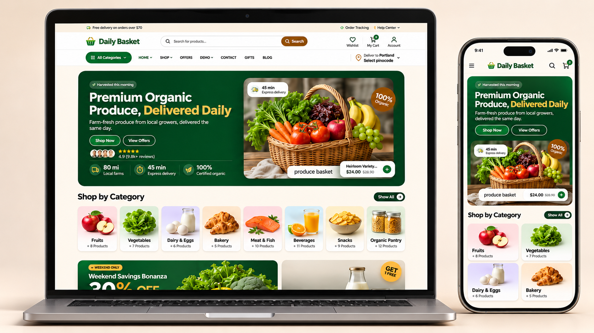

# Daily Basket

Daily Basket is an organic grocery store built with Laravel. Shoppers can browse the catalog,
check out as guests or register to track orders and save favourites. Store staff can manage
products, orders, delivery and storefront content from the admin panel.



- Laravel 12 · PHP 8.2.35+ (8.4 recommended) · MySQL 8 or MariaDB 10.11
- Blade + Alpine.js + Tailwind CSS 4, built with Vite
- English (Arabic available in the platform, switched off for this store)
- 566 automated tests

**Sign-in after installing:** the admin is `ADMIN_EMAIL` from `.env`; its password is
`ADMIN_PASSWORD`, or — if you leave that empty — a random password printed once by
`php artisan db:seed`. **Change every demo password, and delete the demo customer
`customer@example.com`, before any real use.** If you import `database/seed.sql` instead,
set a new admin password straight away with `php artisan store:admin`.

---

## Features

### Storefront
- Homepage from the design's sections — hero, categories, weekend offer with countdown, fresh
  picks with tabs, offers & bundles, deal of the day, product lists, newsletter, promise
  cards — reordered and switched on or off in Online Store → Customize
- Shop, categories and search with price, "on offer" and "in stock" filters, 16 per page
- Product pages: pack sizes, live total, coupon box, the product's deals, nutrition, storage
  tips, reviews
- Addresses with country, state and city; the countries you deliver to are chosen in Settings
- Cart drawer and cart page with a free-delivery bar; three-step guest checkout; card
  (Stripe) or cash on delivery; order page with a tracking timeline; invoices; returns
- Account: orders with one-tap reorder, wishlist, saved addresses
- Content pages: Contact with form, FAQs, Delivery, Returns, Our Growers, Sustainability,
  Careers, Privacy, Terms; a landing page at `/landing/`

### Admin
- Products with variants, media and brands; categories; inventory; CSV import and export
- Orders: fulfilment, refunds, draft orders, payment links, invoices, Aramex labels
- Deals (buy X get Y), discount codes, abandoned-cart emails, subscribers, reviews
- Banners, menus, pages and homepage sections in Online Store → Customize
- Settings: store details, delivery, payments, tax, currencies, email templates, reCAPTCHA
- Analytics with a conversion funnel, activity log, roles and permissions
- **Visitor traffic** (Analytics → Traffic): world map, who is on the shop right now, visits,
  pages and countries; no IP address is stored; bots are counted apart
- **HTML editor (TinyMCE 7)** in every rich text field: headings, lists, links, pictures from
  the media library, YouTube/Vimeo videos, tables, alignment, and a Source code view for HTML
- **Backup & clean-up** (Settings, Owner only): one-click database backup, daily automatic
  backups, and a clean-up of old carts, sessions and statistics that always backs up first
- **Test email** (Settings → Mail server): send a test to any address; failures are explained
  in plain words with the fix; the store logo is embedded in every email
- Guided tours: a welcome screen on each admin's first sign-in, four step-by-step tours on the
  real pages (first product, a new order, payments and delivery, the storefront) and a ? menu
  to continue or restart them; a 1-minute shopper tour on the storefront (English and Arabic)

### Running it
- `store:launch-check` — reports what is not ready before you take real orders (including an
  unpatched PHP version)
- `store:web-check` — loads the live site like a browser and lists blocked scripts, missing
  files and header problems
- `store:backup`, `store:cleanup`, `store:geoip-update` — the backup and traffic features from
  the command line (also scheduled automatically)
- `store:import-design-images` — downloads the design's photos (needs internet)
- `DEMO_MODE` for a public read-only demo
- `ALLOW_FRAMING_FROM` to let a marketplace show the store and landing page in its demo frame

## Local preview

| Page | URL |
|---|---|
| Storefront | [localhost:8080](http://127.0.0.1:8080/) |
| Customer sign-in | [localhost:8080/login](http://127.0.0.1:8080/login) |
| Admin sign-in | [localhost:8080/admin/login](http://127.0.0.1:8080/admin/login) |
| Landing page | [localhost:8080/landing](http://127.0.0.1:8080/landing/) |

With `DEMO_ROLE_LOGIN=true`, the local sign-in pages show one-click, read-only previews
for the demo accounts available in the database. Admin previews use the Owner, Manager,
Orders and Content roles.

## Install

Full guide: **HowToSetup.md** (in the root of this archive — shared hosting, VPS and Docker).
The complete steps for a server are also here:

**Prerequisites:** PHP 8.2.35+ (8.4 recommended; `php -v`) with mbstring, pdo_mysql, gd, zip, intl, curl
(check: `php -m | grep -E "mbstring|pdo_mysql|gd|zip|intl|curl"` — all six must appear) ·
MySQL 8.0+ or MariaDB 10.11+ · Composer 2 · Node.js 20.19+ and npm 10+ (`node --version`,
`npm --version`) — needed to build the front-end.

```bash
# 1. Database (utf8mb4) — replace <REPLACE_WITH_STRONG_PASSWORD>; generate one with: openssl rand -base64 24
mysql -u root -p -e "CREATE DATABASE freshnest CHARACTER SET utf8mb4 COLLATE utf8mb4_unicode_ci;
  CREATE USER 'freshnest'@'localhost' IDENTIFIED BY '<REPLACE_WITH_STRONG_PASSWORD>';
  GRANT ALL PRIVILEGES ON freshnest.* TO 'freshnest'@'localhost';"

# 2. Code and settings
composer install --no-dev --optimize-autoloader     # exact versions from composer.lock
cp .env.example .env && php artisan key:generate
#    edit .env: APP_URL, DB_DATABASE, DB_USERNAME, DB_PASSWORD, ADMIN_EMAIL
#    IMPORTANT: replace the DB_PASSWORD placeholder with the password you created in step 1

# 3. Front-end (exact versions from package-lock.json)
npm ci && npm run build

# 4. Tables, demo shop and your admin account
php artisan migrate --seed --force
#    The admin password is printed ONCE here (unless you set ADMIN_PASSWORD).
#    Copy it immediately; if you miss it, run: php artisan store:admin

# 5. Images and caches
php artisan storage:link
php artisan store:import-design-images
php artisan optimize
php artisan store:launch-check          # lists anything not ready before real orders
```

`--force` skips Laravel's "are you sure?" prompt in production — use it only when `.env` points
at the right database. Or import `database/schema.sql` then `database/seed.sql` (no admin
account inside) and run `php artisan store:admin`.

**Accounts:** customer accounts (storefront) and admin accounts (`/admin`) are completely
separate. A customer cannot open `/admin`; an admin who wants to place an order needs a separate
customer account. **Before going live:** change the admin password and delete the demo
customer `customer@example.com`.

**Security:** see `SECURITY.md` for where every control is enforced (admin route guard, roles,
ownership checks, password reset, throttling, parameterised queries).

**Pinned dependencies:** `composer.lock` and `package-lock.json` are in the root of the archive;
the exact versions of the main packages are listed in `DEPENDENCIES.md`.

## Not included

Compare, a delivery-location picker, blog, gift cards, store locator, member tiers and an
"edit profile" form are in the design but not in the platform, so they are left out.

## Licence

Sold as source code: one licence covers one production store (yours or one client's); you may change
the code freely but not resell or publish it. The full terms are in `LICENSE-NOTE.md`.
